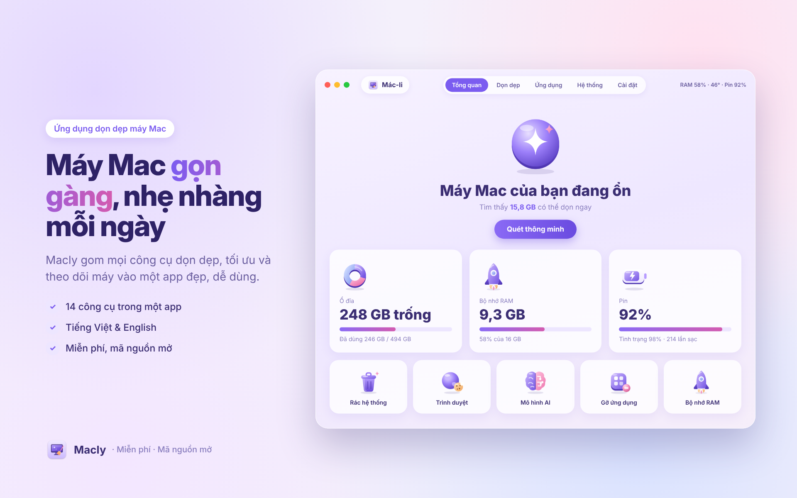
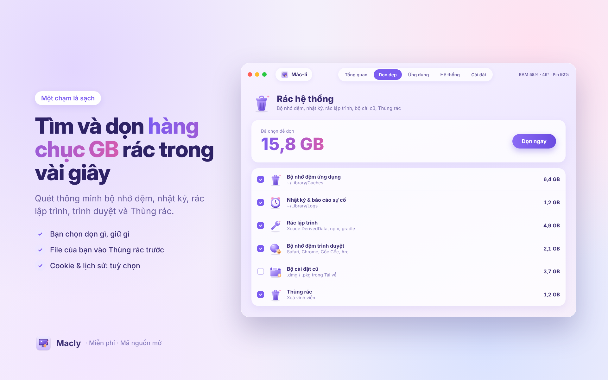
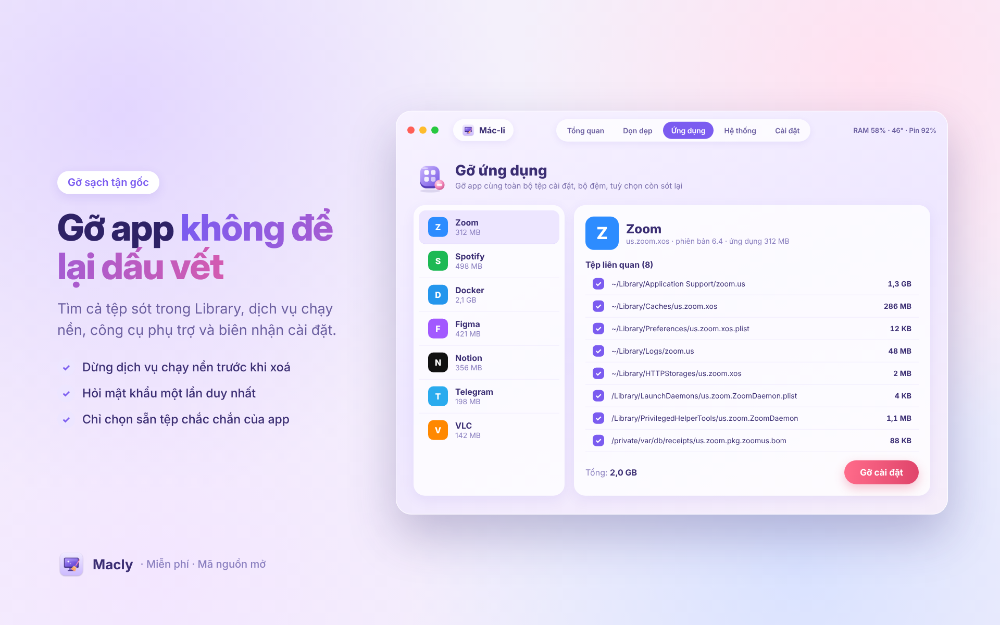
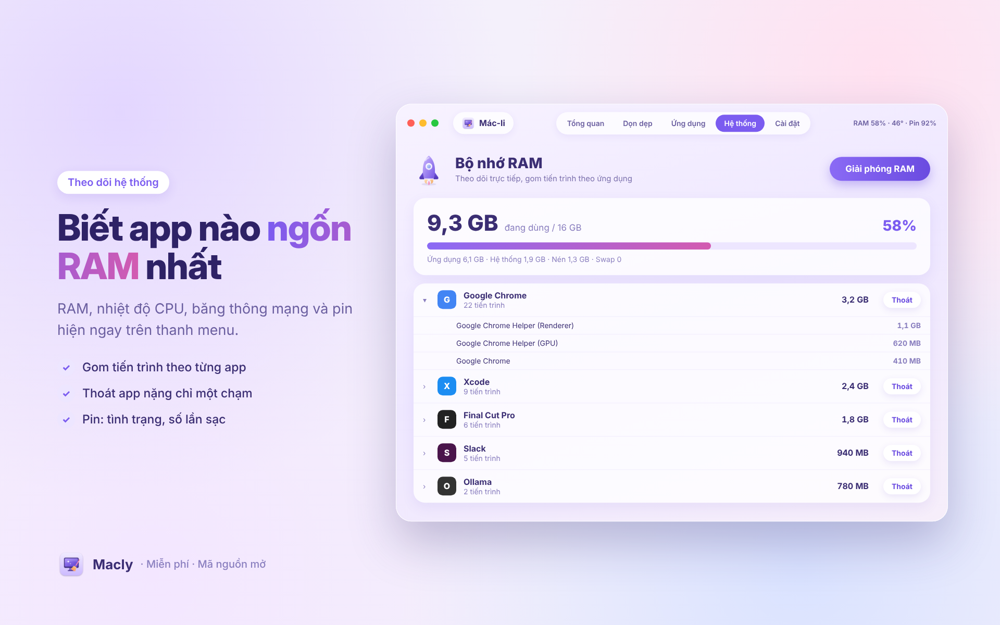

<p align="center"></p>

<h1 align="center">Macly</h1>
<p align="center">Ứng dụng dọn dẹp máy Mac miễn phí, mã nguồn mở · <b>v1.0</b></p>
<p align="center"><a href="../../releases/latest/download/Macly.dmg"><b>⬇️ Tải Macly cho macOS (.dmg)</b></a></p>

## Tên sản phẩm
**Macly** (tiếng Việt: *Mác-li*): app dọn dẹp và tối ưu máy Mac, viết bằng SwiftUI.

## Ảnh giới thiệu
<p align="center">
  
</p>
<p align="center">
  
  
</p>
<p align="center">
  
  
</p>

## Cài đặt
1. **[Tải file Macly.dmg](../../releases/latest/download/Macly.dmg)** (macOS 13 trở lên, chip Apple hoặc Intel).
2. Mở file vừa tải, **kéo Macly vào thư mục Applications**.
3. Lần đầu mở: vào Applications, **chuột phải vào Macly → Mở → Mở**.
   Nếu macOS vẫn chặn: *Cài đặt hệ thống → Quyền riêng tư & Bảo mật* → kéo xuống bấm **Vẫn mở**.
4. Trong app bấm **Cấp quyền** → bật Macly trong *Truy cập toàn bộ ổ đĩa* để quét được đầy đủ.

> Macly chưa ký bằng tài khoản Apple Developer nên macOS hỏi xác nhận ở lần mở đầu tiên. Đây là bước bình thường với app mã nguồn mở.

## Chức năng
- **Dọn dẹp:** rác hệ thống, trình duyệt (cookie / lịch sử tuỳ chọn), mô hình AI (Ollama, Hugging Face, LM Studio), file lớn & cũ, file trùng lặp
- **Bản đồ dung lượng:** xem thư mục nào chiếm chỗ
- **Gỡ ứng dụng:** gỡ sạch cả tệp sót, dịch vụ chạy nền, biên nhận cài đặt
- **Hệ thống:** khởi động cùng máy, cập nhật ứng dụng, RAM theo từng app, pin, bảo trì
- **Tiện ích:** lịch sử dọn dẹp, danh sách bỏ qua, chỉ số trên thanh menu, 3 biểu tượng app để chọn
- **An toàn:** file của bạn luôn vào Thùng rác trước, khôi phục được

## Kĩ thuật
- SwiftUI + AppKit, Swift Package Manager, macOS 13 trở lên, chạy được trên Apple Silicon và Intel
- Tự build từ mã nguồn: chỉ cần Xcode Command Line Tools (`xcode-select --install`)

```bash
bash build.sh       # build, ký, cài vào ~/Applications và mở app
bash make-dmg.sh    # tạo file cài đặt dist/Macly-1.0.dmg
```

## Ngôn ngữ
Tiếng Việt · English. App tự nhận theo ngôn ngữ máy, đổi bằng nút cờ ở góc trên.

## Phiên bản
**v1.0** (11/2026)

---
[MIT License](LICENSE) · Ủng hộ tác giả: [Ko-fi](https://ko-fi.com/ngthuthuy2172) ☕
